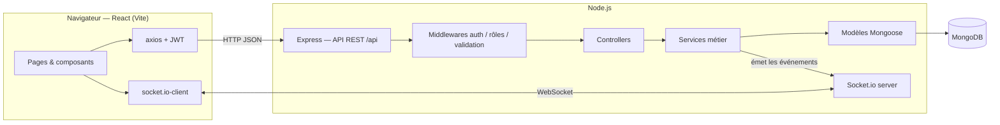
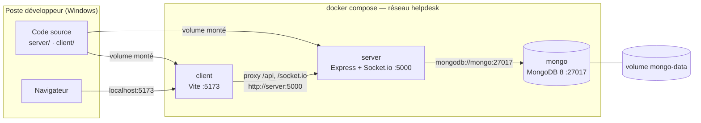
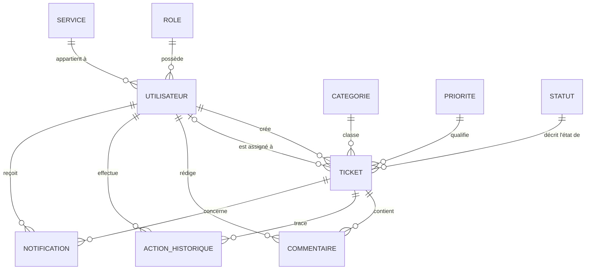
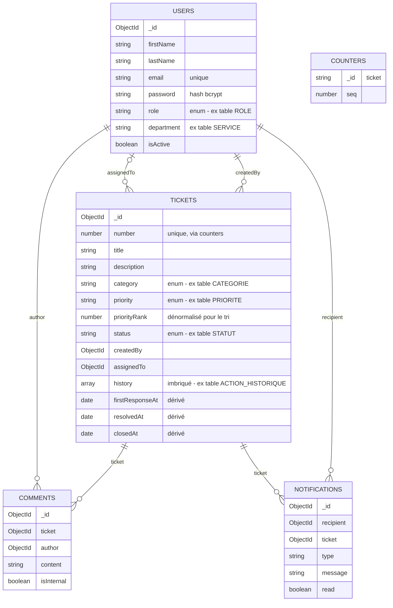
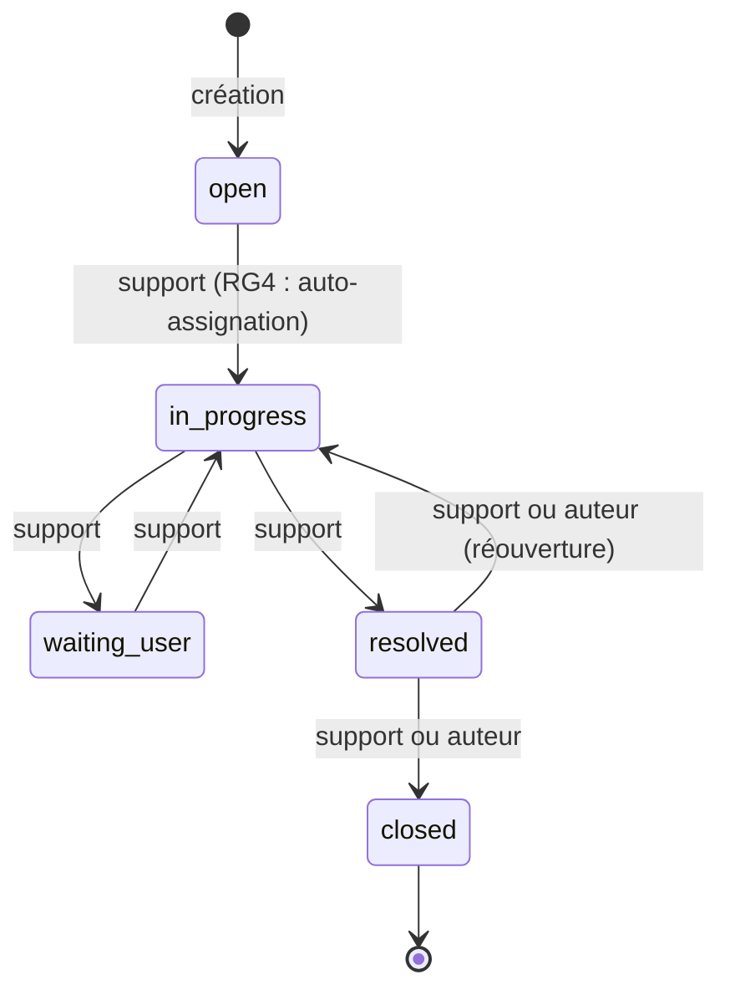

# Dossier technique — HelpDesk IT (MERN)

> Version 0.1 — conception (Sprint 1). Sera complété au fil des sprints.

## 1. Architecture



**Principe clé :** les écritures passent **toujours par l'API REST** (validation, droits, persistance). Après écriture, la couche service **émet** l'événement Socket.io vers les rooms concernées. Le socket sert à **pousser**, pas à écrire → une seule source de vérité pour les règles métier.

### Arborescence (monorepo)

```
helpdesk/
├── server/
│   ├── src/
│   │   ├── config/        # env.js (variables validées), db.js (connexion Mongoose)
│   │   ├── models/        # User, Ticket, Comment, Notification, Counter
│   │   ├── routes/        # index.js (montage /api, une ligne par US) + auth, tickets…
│   │   ├── controllers/
│   │   ├── services/      # logique métier (transitions, historique, notifications)
│   │   ├── middlewares/   # notFound, errorHandler, auth, requireRole
│   │   ├── socket/        # initSocket / getIO, auth handshake, handlers
│   │   ├── utils/         # AppError
│   │   ├── app.js         # point d'entrée Express : configuration de l'application
│   │   └── server.js      # point d'entrée Node.js : démarrage (BDD, HTTP, Socket.io)
│   ├── seed/
│   └── .env.example
├── client/
│   └── src/
│       ├── api/           # instance axios
│       ├── context/       # AuthContext, SocketContext
│       ├── pages/
│       ├── components/
│       └── hooks/
├── docs/
└── README.md
```

### Deux points d'entrée côté serveur : `app.js` et `server.js`

Le serveur est volontairement découpé en **deux fichiers d'entrée** aux responsabilités distinctes :

| Fichier | Rôle | Contenu |
|---------|------|---------|
| **`app.js`** — l'application **Express** | *Décrit* l'application, sans la lancer | Création de `app = express()`, middlewares globaux (`helmet`, `cors`, `express.json` limité à 100 ko), montage des routes `/api`, puis `notFound` et `errorHandler` en fin de chaîne. **Exporte** `app` (`export default`). |
| **`server.js`** — le processus **Node.js** | *Démarre* l'application | Variables validées (`config/env.js`), connexion MongoDB, création du serveur HTTP (`http.createServer(app)`), branchement de **Socket.io** sur ce même serveur, `listen(PORT)`, **arrêt propre**. |

Le serveur est écrit en **ES Modules** (`"type": "module"`) : `import` / `export`, extension `.js` obligatoire dans les imports locaux, `await` utilisable au niveau du module.

```js
// server.js (extrait)
import http from 'node:http';
import { env } from './config/env.js';
import { connectDB } from './config/db.js';
import { initSocket } from './socket/index.js';
import app from './app.js';

await connectDB();                       // await au niveau du module (ES Modules)
const server = http.createServer(app);   // HTTP partagé…
const io = initSocket(server);           // …par l'API REST et Socket.io
server.listen(env.port);
```

**Arrêt propre** (`SIGINT` = Ctrl+C, `SIGTERM` = `docker stop`, `SIGUSR2` = redémarrage nodemon) : le serveur cesse d'accepter des connexions, ferme Socket.io et le serveur HTTP, puis la connexion MongoDB, et sort. Un délai de 10 s force l'arrêt si quelque chose bloque. Les requêtes en cours ne sont pas coupées brutalement et aucune connexion à la base n'est laissée ouverte.

**Démarrage défensif** : `config/env.js` vérifie au lancement les variables indispensables (`MONGO_URI`, `JWT_SECRET`) et refuse de démarrer avec un message explicite si l'une manque.

**Pourquoi cette séparation ?**
- **Socket.io a besoin du serveur HTTP Node**, pas de l'application Express : `server.js` crée ce serveur et y attache à la fois Express et Socket.io, sur le **même port**.
- **Testabilité** : `app.js` s'importe sans ouvrir de port ni se connecter à la base, ce qui permet de tester les routes (ex. Supertest) indépendamment du démarrage.
- **Montée en charge** : seul `server.js` change pour lancer plusieurs processus (module `cluster` / PM2, adapter Redis pour Socket.io) ; la configuration de l'application reste identique.
- **Lisibilité** : *quoi* (routes, middlewares) d'un côté, *comment on démarre* (BDD, port, temps réel) de l'autre.

## 2. Choix techniques

| Besoin | Choix | Justification |
|--------|-------|---------------|
| Imposé | Node.js, Express, MongoDB, Mongoose, React, Socket.io | Contraintes du sujet |
| Build front | **Vite** | Démarrage et HMR rapides, CRA déprécié |
| Routage front | React Router | Standard, gestion des routes protégées |
| Authentification | **JWT** (Bearer) + **bcrypt** | Stateless → compatible clustering ; même token réutilisé au handshake Socket.io |
| Validation des entrées | express-validator (ou Joi) | Ne jamais faire confiance au client |
| Sécurité HTTP | helmet, cors (origine du front), express-rate-limit sur `/auth` | Bonnes pratiques de base |
| Graphiques | Recharts | Simple à intégrer en React |
| Configuration | dotenv | Secrets hors du dépôt |
| Environnement de développement | **Docker + Docker Compose** (image `node:20-alpine`, `mongo:8`) | Environnement **identique** pour toute l'équipe (version de Node, dépendances installées par `npm ci` depuis le lockfile, version de MongoDB) ; démarrage complet en une commande, y compris pour le jury ; préfigure le déploiement conteneurisé et la montée en charge (plusieurs instances `server`) |
| Monorepo | npm workspaces (`server`, `client`) | Un seul `package-lock.json`, une commande pour tout installer / lancer |

### Environnement Docker



| Élément | Choix | Raison |
|---------|-------|--------|
| Une seule image (`Dockerfile` racine) pour `server` et `client` | Monorepo à lockfile unique | Dépendances installées une fois, cohérentes entre les deux applications |
| Code monté en volume, `node_modules` conservés dans l'image | Développement à chaud | On édite sur l'hôte ; les modules restent ceux compilés pour Linux |
| `nodemon --legacy-watch` et `usePolling` côté Vite | Volumes Windows | Les événements de fichiers Windows ne traversent pas les volumes : détection par scrutation |
| Service `mongo` + volume nommé `mongo-data` | Base locale par défaut | Fonctionne hors connexion, données persistées entre redémarrages ; Atlas reste possible via `MONGO_URI` |
| Healthcheck MongoDB + `depends_on: service_healthy` | Ordre de démarrage | L'API ne démarre qu'une fois la base prête |
| Secrets via `env_file: server/.env` (exclu de l'image par `.dockerignore`) | Sécurité | Aucun secret dans l'image ni dans Git |
| Numérotation tickets | Collection `counters` + `findOneAndUpdate($inc)` | Numéro lisible `HD-0042` atomique, plus parlant qu'un ObjectId pour l'utilisateur |

## 3. Modèle de données

### 3.1 Démarche

Nous avons conçu les données en trois étapes :

1. **MCD (Merise)** : modéliser le domaine métier indépendamment de toute technologie : quelles entités, quelles associations, quelles cardinalités.
2. **MLD relationnel normalisé (3FN)** : la traduction « classique » en tables, qui sert de référence.
3. **Modèle document dénormalisé (MongoDB)** : transformation guidée par les **cas d'usage** de l'application, avec une justification pour chaque table supprimée, fusionnée ou conservée.

Cette démarche permet de montrer que la structure MongoDB est un **choix raisonné** à partir d'un modèle complet, et non une absence de modélisation.

### 3.2 MCD — Modèle conceptuel de données



**Entités et propriétés**

| Entité | Propriétés |
|--------|-----------|
| UTILISATEUR | id, prénom, nom, email, mot de passe, actif, date de création |
| ROLE | id, libellé (utilisateur, technicien, administrateur) |
| SERVICE | id, nom (Comptabilité, RH…) |
| TICKET | id, numéro, titre, description, date de création, date de 1ʳᵉ prise en charge, date de résolution, date de clôture |
| CATEGORIE | id, libellé (matériel, logiciel, réseau, accès, autre) |
| PRIORITE | id, libellé, rang (basse 1 → critique 4) |
| STATUT | id, libellé (ouvert, en cours, en attente utilisateur, résolu, fermé) |
| COMMENTAIRE | id, contenu, interne (oui/non), date |
| ACTION_HISTORIQUE | id, type d'action, ancienne valeur, nouvelle valeur, date |
| NOTIFICATION | id, type, message, lue (oui/non), date |

**Associations et cardinalités (notation Merise)**

| Association | Côté A | Côté B | Lecture |
|-------------|--------|--------|---------|
| Posséder | UTILISATEUR (1,1) | ROLE (0,n) | Un utilisateur a exactement un rôle ; un rôle est porté par 0 à n utilisateurs |
| Appartenir | UTILISATEUR (0,1) | SERVICE (0,n) | Un utilisateur appartient au plus à un service |
| Créer | TICKET (1,1) | UTILISATEUR (0,n) | Un ticket a un seul demandeur ; un utilisateur crée 0 à n tickets |
| Être assigné | TICKET (0,1) | UTILISATEUR (0,n) | Un ticket est assigné à au plus un technicien |
| Classer / Qualifier / Décrire | TICKET (1,1) | CATEGORIE / PRIORITE / STATUT (0,n) | Un ticket a une seule catégorie, priorité et un seul statut à un instant donné |
| Contenir | COMMENTAIRE (1,1) | TICKET (0,n) | Un commentaire appartient à un seul ticket |
| Rédiger | COMMENTAIRE (1,1) | UTILISATEUR (0,n) | Un commentaire a un seul auteur |
| Tracer | ACTION_HISTORIQUE (1,1) | TICKET (1,n) | Toute action appartient à un ticket ; un ticket a au moins l'action « création » |
| Effectuer | ACTION_HISTORIQUE (1,1) | UTILISATEUR (0,n) | Une action est faite par un utilisateur |
| Recevoir | NOTIFICATION (1,1) | UTILISATEUR (0,n) | Une notification a un seul destinataire |
| Concerner | NOTIFICATION (1,1) | TICKET (0,n) | Une notification porte sur un ticket |

### 3.3 MLD relationnel normalisé (référence)

Traduction directe du MCD en 3ᵉ forme normale (<u>clé primaire</u>, #clé étrangère) :

- **role** (<u>id</u>, libelle)
- **service** (<u>id</u>, nom)
- **utilisateur** (<u>id</u>, prenom, nom, email, mot_de_passe, actif, cree_le, #role_id, #service_id)
- **categorie** (<u>id</u>, libelle)
- **priorite** (<u>id</u>, libelle, rang)
- **statut** (<u>id</u>, libelle)
- **ticket** (<u>id</u>, numero, titre, description, cree_le, pris_en_charge_le, resolu_le, ferme_le, #createur_id, #assigne_id, #categorie_id, #priorite_id, #statut_id)
- **commentaire** (<u>id</u>, contenu, interne, cree_le, #ticket_id, #auteur_id)
- **action_historique** (<u>id</u>, type, ancienne_valeur, nouvelle_valeur, effectue_le, #ticket_id, #utilisateur_id)
- **notification** (<u>id</u>, type, message, lue, cree_le, #destinataire_id, #ticket_id)

**10 tables.** Ce modèle est correct et sans redondance, mais il est mal adapté à nos usages. Par exemple, afficher **la page « Détail ticket »** demande de joindre `ticket` + `utilisateur` (créateur) + `utilisateur` (assigné) + `categorie` + `priorite` + `statut` + `action_historique` + `utilisateur` (auteur de chaque action) + `commentaire` + `utilisateur` (auteur de chaque commentaire), soit **une dizaine de jointures** pour l'écran le plus consulté de l'application.

### 3.4 Pourquoi un schéma dénormalisé en NoSQL ?

En relationnel, on modélise **les entités** puis on reconstitue les vues par jointures. En MongoDB, on modélise **selon les accès** : *ce qui est lu ensemble est stocké ensemble*.

| Raison | Explication |
|--------|-------------|
| **Pas de jointure native** | MongoDB n'a pas de `JOIN` ; `$lookup` (ou `populate` de Mongoose) existe mais coûte des requêtes supplémentaires. Moins on en a besoin, plus les lectures sont rapides. |
| **Atomicité au niveau du document** | Une écriture sur un seul document est atomique. Si le statut et son entrée d'historique sont dans le même document, ils sont mis à jour **ensemble ou pas du tout**, sans transaction multi-documents. |
| **Application très majoritairement en lecture** | Une file de tickets est consultée bien plus souvent qu'elle n'est modifiée : on optimise la lecture, quitte à un peu plus de travail à l'écriture. |
| **Montée en charge horizontale** | Avec le sharding, des données réparties sur plusieurs serveurs rendent les jointures très coûteuses. Des documents autonomes se répartissent sans difficulté. |
| **Cohérence avec la pile JavaScript** | Un document correspond directement à l'objet manipulé par l'API et par React. |

**Règles de décision appliquées**

| Situation | Choix | Exemple |
|-----------|-------|---------|
| Données de référence **fixes**, sans attribut propre, dont le comportement est codé dans l'application | **Valeur énumérée** (enum) dans le document | rôle, catégorie, statut, priorité |
| Relation 1-n **bornée**, données **toujours lues avec le parent**, n'existant pas sans lui | **Imbriquer** (sous-document / tableau) | historique d'un ticket |
| Relation 1-n **non bornée**, ou données **interrogées seules**, ou **cycle de vie propre** | **Collection séparée + référence** | commentaires, notifications |
| Entité **partagée** et **modifiable** (référencée depuis de nombreux documents) | **Référence** (`ObjectId`) | utilisateurs |

### 3.5 Décisions table par table

| Table du MLD | Décision | Justification |
|--------------|----------|---------------|
| **role** | ❌ **Supprimée** → `users.role` (enum `user` / `technician` / `admin`) | 3 valeurs fixes, sans attribut. Les droits associés sont **codés dans l'application** (middleware `requireRole`) : ajouter un rôle en base sans modifier le code n'aurait aucun effet. Le rôle est lu à **chaque requête** (contrôle d'accès) et transporté dans le JWT : une jointure ici serait coûteuse et inutile. |
| **service** | ❌ **Supprimée** → `users.department` (chaîne) | Simple libellé, sans attribut ni règle métier. Il sert à l'affichage et au regroupement statistique (`$group` sur une chaîne fonctionne directement). Si l'entreprise voulait gérer ses services (responsable, site…), on recréerait une collection. |
| **categorie** | ❌ **Supprimée** → `tickets.category` (enum) | Liste courte et stable. Une catégorie n'a pas d'autre propriété que son libellé. La validation est faite par Mongoose (`enum`). **Compromis assumé** : ajouter une catégorie nécessite un déploiement. Si un administrateur devait gérer les catégories lui-même (évolution possible), on la rétablirait en collection. |
| **priorite** | ❌ **Supprimée** → `tickets.priority` (enum) + `tickets.priorityRank` (1 à 4) | Valeurs fixes. Le **rang** est **dénormalisé** dans le ticket : trier sur le libellé donnerait un ordre alphabétique faux (`critical` < `high` < `low` < `medium`). Stocker le rang permet de trier la file technicien par urgence avec un index. |
| **statut** | ❌ **Supprimée** → `tickets.status` (enum) | Les statuts portent de la **logique** (transitions autorisées, règle RG3) qui vit dans le code. Une table n'apporterait rien et ne garantirait pas les transitions. |
| **action_historique** | 🔀 **Imbriquée** → `tickets.history[]` | Relation 1-n **bornée** (quelques dizaines d'actions au maximum), **toujours affichée avec le ticket**, sans existence propre. L'imbrication permet de mettre à jour le statut **et** d'ajouter l'entrée d'historique dans **une seule écriture atomique** (règle RG5). |
| **utilisateur** | ✅ **Conservée** → collection `users`, **référencée** | Entité centrale, partagée par les tickets, commentaires, notifications et historique. Ses données (nom, rôle, état actif) **changent** : les recopier dans chaque document obligerait à les mettre à jour partout. On garde une seule source et on utilise `populate` sur les champs affichés. |
| **ticket** | ✅ **Conservée** → collection `tickets` | Document central de l'application, enrichi des enums et de l'historique. |
| **commentaire** | ✅ **Conservée** → collection `comments` | Relation 1-n **non bornée** : imbriquer les commentaires ferait grossir le ticket sans limite (plafond de **16 Mo** par document) et réécrire tout le ticket à chaque message. La collection séparée permet la **pagination**, le **filtrage des notes internes** pour un utilisateur (RG6) et l'insertion légère en temps réel. Elle se prête aussi au sharding par ticket. |
| **notification** | ✅ **Conservée** → collection `notifications` | **Cycle de vie indépendant** : interrogées **par destinataire** (et non par ticket), marquées lues une par une, et purgeables automatiquement (index TTL possible). Les imbriquer dans `users` ou `tickets` compliquerait toutes ces opérations. |
| — | ➕ **Ajoutée** → collection `counters` | Besoin technique sans équivalent dans le MCD : MongoDB n'a pas d'auto-incrément. Un compteur incrémenté atomiquement (`findOneAndUpdate` + `$inc`) génère le numéro lisible `HD-0042`. |

**Bilan : 10 tables → 5 collections** (`users`, `tickets`, `comments`, `notifications`, `counters`).

**Champs dérivés stockés (dénormalisation de calcul)** : `firstResponseAt`, `resolvedAt` et `closedAt` pourraient être retrouvés en parcourant l'historique. Ils sont stockés directement dans le ticket pour que les statistiques (délai de prise en charge, délai de résolution) soient de simples calculs dans l'Aggregation Pipeline, et puissent être indexés.

### 3.6 Schéma dénormalisé (modèle document)



**users**
```js
{
  _id: ObjectId,
  firstName: String,        // requis
  lastName: String,         // requis
  email: String,            // requis, unique, lowercase
  password: String,         // hash bcrypt, select: false
  role: 'user' | 'technician' | 'admin',   // défaut 'user' (ex-table ROLE)
  department: String,       // ex. Comptabilité (ex-table SERVICE)
  isActive: Boolean,        // défaut true — on désactive plutôt que supprimer
  createdAt, updatedAt
}
```

**tickets**
```js
{
  _id: ObjectId,
  number: Number,           // unique, via counters → affiché HD-0042
  title: String,            // requis, 5–120 car.
  description: String,      // requis
  category: 'hardware' | 'software' | 'network' | 'access' | 'other',   // ex-table CATEGORIE
  priority: 'low' | 'medium' | 'high' | 'critical',                      // ex-table PRIORITE
  priorityRank: Number,     // 1 à 4, dérivé de priority, pour trier par urgence
  status: 'open' | 'in_progress' | 'waiting_user' | 'resolved' | 'closed', // ex-table STATUT
  createdBy: ObjectId → users,
  assignedTo: ObjectId → users | null,
  history: [{               // imbriqué (ex-table ACTION_HISTORIQUE)
    action: 'created' | 'status_changed' | 'priority_changed' | 'assigned',
    from: String, to: String,
    by: ObjectId → users,
    at: Date
  }],
  firstResponseAt: Date,    // 1ʳᵉ prise en charge → stat délai de prise en charge
  resolvedAt: Date,         // → stat délai de résolution
  closedAt: Date,
  createdAt, updatedAt
}
```

**comments**
```js
{
  _id: ObjectId,
  ticket: ObjectId → tickets,
  author: ObjectId → users,
  content: String,          // requis
  isInternal: Boolean,      // note interne support (RG6)
  createdAt
}
```

**notifications**
```js
{
  _id: ObjectId,
  recipient: ObjectId → users,
  type: 'ticket_created' | 'ticket_assigned' | 'status_changed' | 'new_comment',
  ticket: ObjectId → tickets,
  message: String,
  read: Boolean,            // défaut false
  createdAt
}
```

**counters** — `{ _id: 'ticket', seq: Number }`

### 3.7 Compromis de la dénormalisation et parades

| Risque | Parade mise en place |
|--------|---------------------|
| Pas de clé étrangère : un document peut référencer un utilisateur supprimé | Les comptes ne sont **jamais supprimés**, seulement désactivés (`isActive: false`, règle RG8) |
| Schéma souple → documents incohérents | **Mongoose** impose types, champs requis, enums et validations |
| Données dérivées (`priorityRank`, dates) désynchronisées | Calculées **uniquement côté serveur** (hook Mongoose / couche service), jamais envoyées par le client |
| Valeurs de référence figées dans le code (catégories…) | Accepté pour cette version ; évolution identifiée si l'administration doit les gérer |
| Affichage des noms (créateur, auteur) nécessite une lecture de `users` | `populate` limité aux champs utiles (`firstName lastName role`) |

### 3.8 Index

| Collection | Index | Requête servie |
|-----------|-------|----------------|
| users | `{ email: 1 }` unique | login |
| tickets | `{ number: 1 }` unique | accès par numéro |
| tickets | `{ createdBy: 1, createdAt: -1 }` | « Mes tickets » |
| tickets | `{ status: 1, priorityRank: -1, createdAt: 1 }` | file technicien : filtrée par statut, la plus urgente puis la plus ancienne d'abord |
| tickets | `{ assignedTo: 1, status: 1 }` | « mes tickets assignés », charge par technicien |
| comments | `{ ticket: 1, createdAt: 1 }` | fil du ticket |
| notifications | `{ recipient: 1, read: 1, createdAt: -1 }` | centre de notifications |

### 3.9 Implémentation Mongoose

Les schémas sont dans `server/src/models/` (point d'import unique `models/index.js`).

| Fichier | Points clés |
|---------|-------------|
| `constants.js` | Valeurs de référence remplaçant les tables ROLE / CATEGORIE / PRIORITE / STATUT : `ROLES`, `CATEGORIES`, `PRIORITIES` + `PRIORITY_RANK`, `STATUSES` + `STATUS_TRANSITIONS` (RG3), `HISTORY_ACTIONS`, `NOTIFICATION_TYPES`. Une seule source de vérité pour les enums et les règles. |
| `User.js` | Email unique, normalisé (minuscules, trim) et vérifié ; `password` en `select: false` et retiré de `toJSON` ; `isActive` (RG8) ; virtuel `fullName`. |
| `Ticket.js` | Historique **imbriqué** (sous-schéma sans `_id`) ; enums avec messages en français ; virtuel `reference` (`HD-0042`) ; index du §3.8. |
| `Comment.js` | Collection séparée, `isInternal` (RG6), `createdAt` seul (un commentaire n'est pas modifié). |
| `Notification.js` | Collection séparée, `read` par défaut à `false`. |
| `Counter.js` | `Counter.next('ticket')` : `findOneAndUpdate` + `$inc` + `upsert`, **atomique** (pas de doublon en cas de créations simultanées). |

**Hooks du ticket** (la logique de cohérence est dans le modèle, pas dans chaque contrôleur) :

| Hook | Rôle | Pourquoi ce moment |
|------|------|--------------------|
| `pre('validate')` | `priorityRank` recalculé depuis `priority` | Le rang n'est jamais fourni par le client |
| `pre('save')` (création) | Attribution du numéro + entrée d'historique `created` | **Après** validation : un ticket invalide ne consomme pas de numéro → numérotation sans trous |
| `pre('findOneAndUpdate' / 'updateOne')` | Resynchronise `priorityRank` si `priority` est modifiée par une requête de mise à jour | Filet de sécurité : les services privilégient `doc.save()` |

**Vérifications effectuées** (base de test jetable) : normalisation de l'email, mot de passe jamais renvoyé, doublon d'email → 409, validations → 400 avec détail par champ, numérotation séquentielle **sans doublon sur 20 créations simultanées** et **sans trou** après des créations invalides, `priorityRank` synchronisé (création, `save`, `findByIdAndUpdate`), file technicien triée par urgence **en utilisant l'index** `{ status, priorityRank, createdAt }` (vérifié par `explain()`), `populate` du créateur sans mot de passe.

## 4. API REST

Base : `/api` — JSON — Auth : header `Authorization: Bearer <token>`.
Format d'erreur : `{ "error": { "code": "FORBIDDEN", "message": "..." } }`.

### Auth
| Méthode | Route | Accès | Description |
|---------|-------|-------|-------------|
| POST | `/auth/register` | public | Création de compte (rôle `user`) → `{ token, user }` |
| POST | `/auth/login` | public | → `{ token, user }` |
| GET | `/auth/me` | connecté | Profil courant |

**Détail (US01)**

| Route | Corps | Succès | Erreurs |
|-------|-------|--------|---------|
| `POST /auth/register` | `{ firstName, lastName, email, password, department? }` | `201 { token, user }` | `400 VALIDATION_ERROR` (mot de passe ≥ 8 caractères avec une lettre et un chiffre, email valide…) · `409 DUPLICATE` (email déjà utilisé) · `429 TOO_MANY_REQUESTS` |
| `POST /auth/login` | `{ email, password }` | `200 { token, user }` | `400 VALIDATION_ERROR` · `401 INVALID_CREDENTIALS` · `403 ACCOUNT_DISABLED` · `429 TOO_MANY_REQUESTS` |
| `GET /auth/me` | — (en-tête `Authorization: Bearer <token>`) | `200 { user }` | `401 UNAUTHORIZED` (pas de token) · `401 INVALID_TOKEN` · `401 TOKEN_EXPIRED` · `401` compte désactivé |

**Sécurité de l'authentification**

| Mesure | Mise en œuvre | Menace couverte |
|--------|---------------|-----------------|
| Hash des mots de passe | bcrypt, coût 12 (hook `pre('save')` du modèle `User`) | Fuite de la base : mots de passe non récupérables |
| Mot de passe jamais exposé | `select: false` + retrait dans `toJSON` | Fuite par une réponse de l'API |
| Rôle imposé à l'inscription | Le champ `role` du client est ignoré, toujours `user` | Auto-promotion en administrateur |
| JWT signé HS256, algorithme imposé à la vérification | `jsonwebtoken`, `algorithms: ['HS256']` | Jeton falsifié, attaque `alg: none` |
| Compte vérifié à chaque requête | `authenticate` recharge l'utilisateur et vérifie `isActive` | Jeton encore valide d'un compte désactivé (RG8) |
| Message et durée identiques en cas d'échec | Même `401 INVALID_CREDENTIALS` ; comparaison bcrypt factice si l'email est inconnu | Énumération des comptes (par le message ou par le temps de réponse) |
| Limitation des tentatives | `express-rate-limit` : 20 requêtes / 15 min / IP sur `register` et `login` | Force brute, création de comptes en masse |

Derrière un reverse proxy en production, activer `app.set('trust proxy', 1)` pour que la limitation se fasse sur l'IP réelle du client.

### Tickets
| Méthode | Route | Accès | Description |
|---------|-------|-------|-------------|
| GET | `/tickets` | connecté | Liste paginée. `user` : ses tickets (RG1). Filtres `?status=&priority=&category=&assignedTo=me&q=&page=&limit=&sort=` |
| POST | `/tickets` | connecté | Créer un ticket |
| GET | `/tickets/:id` | propriétaire / staff | Détail + historique |
| PATCH | `/tickets/:id` | staff (titre/desc : propriétaire si `open`) | Modifier titre, description, catégorie, priorité |
| PATCH | `/tickets/:id/status` | staff ; user pour `closed` / réouverture | `{ status }` — transitions RG3 |
| PATCH | `/tickets/:id/assign` | tech (soi-même) / admin | `{ assignedTo }` |

**Détail du cycle de vie (US05)** — routes dans `routes/ticketWorkflowRoutes.js`, règles dans `services/ticketWorkflowService.js`.



| Route | Règles | Réponses |
|-------|--------|----------|
| `PATCH /tickets/:id/status` `{ status }` | RG3 transitions ci-dessus ; RG2 l'auteur ne peut que fermer ou rouvrir un ticket **résolu** ; RG4 passage en cours sans assigné → assigné à l'agent ; RG5 entrée `status_changed` (+ `assigned`) ; dates : `firstResponseAt` (1ʳᵉ prise en charge), `resolvedAt` (effacée à la réouverture), `closedAt` | `200 { ticket }` · `400` statut / id invalide · `403` action réservée au support · `404` ticket inexistant **ou d'un autre utilisateur** · `409 INVALID_TRANSITION` (`details.allowed`) · `409 CONCURRENT_UPDATE` |
| `PATCH /tickets/:id/assign` `{ assignedTo: <id> \| "me" \| null }` | Support uniquement ; un technicien ne peut que **se** l'assigner, et seulement si le ticket est libre ; l'admin assigne à tout membre **actif** du support ou désassigne (`null`) ; ticket fermé non réassignable ; idempotent ; entrée `assigned` (`from` / `to`) ; `firstResponseAt` à la 1ʳᵉ assignation | `200 { ticket }` · `400 INVALID_ASSIGNEE` · `403` · `404` · `409 ALREADY_ASSIGNED` · `409 TICKET_CLOSED` · `409 CONCURRENT_UPDATE` |

**Choix de conception**
- **Une seule écriture** : statut, historique, assignation et dates sont modifiés sur le document puis enregistrés par un unique `ticket.save()` — atomique, car tout est dans le même document (intérêt de l'historique imbriqué).
- **Verrou optimiste** (`optimisticConcurrency: true` sur `Ticket`) : si deux agents modifient le même ticket simultanément, le second reçoit `409 CONCURRENT_UPDATE` au lieu d'écraser silencieusement le premier.
- **404 plutôt que 403** pour le ticket d'un autre utilisateur (`services/ticketAccess.js`, réutilisable par toutes les routes `/tickets/:id`) : on ne révèle pas l'existence du ticket.
- **Règles de rôle dans le service**, pas dans un middleware : elles dépendent du ticket (auteur, statut, assigné), pas seulement du rôle.

### Commentaires
| Méthode | Route | Accès | Description |
|---------|-------|-------|-------------|
| GET | `/tickets/:id/comments` | propriétaire / staff | Notes internes exclues pour `user` |
| POST | `/tickets/:id/comments` | propriétaire / staff | `{ content, isInternal }` (`isInternal` ignoré pour `user`) |

### Utilisateurs (admin)
| Méthode | Route | Accès | Description |
|---------|-------|-------|-------------|
| GET | `/users` | admin (tech : `?role=technician` pour la liste d'assignation) | Liste |
| PATCH | `/users/:id` | admin | `{ role, isActive }` |

### Notifications
| Méthode | Route | Accès | Description |
|---------|-------|-------|-------------|
| GET | `/notifications` | connecté | Les miennes, non lues d'abord |
| PATCH | `/notifications/:id/read` | destinataire | Marquer lue |
| PATCH | `/notifications/read-all` | connecté | Tout marquer lu |

### Statistiques (admin)
| Méthode | Route | Description |
|---------|-------|-------------|
| GET | `/stats/overview` | Nb de tickets par statut et par priorité |
| GET | `/stats/by-category` | Volume + délai moyen de résolution par catégorie |
| GET | `/stats/technicians` | Tickets ouverts / résolus par technicien |
| GET | `/stats/timeline?from=&to=` | Tickets créés / résolus par jour |

Codes : `200` OK · `201` créé · `400` validation · `401` non authentifié · `403` interdit · `404` introuvable · `409` conflit (email existant, transition invalide).

### Gestion des erreurs

Toutes les erreurs passent par un **middleware unique** (`middlewares/errorHandler.js`), placé en dernier dans `app.js`. Le client reçoit **toujours** le même format :

```json
{ "error": { "code": "VALIDATION_ERROR", "message": "Données invalides", "details": { "title": "Le titre est requis" } } }
```

| Origine | HTTP | `code` |
|---------|------|--------|
| `throw AppError.notFound(...)` / `.forbidden()` / `.conflict()`… (erreurs métier) | selon l'erreur | `NOT_FOUND`, `FORBIDDEN`, `CONFLICT`, ou code dédié (ex. `INVALID_TRANSITION`) |
| Route inexistante (`middlewares/notFound.js`) | 404 | `NOT_FOUND` |
| Validation Mongoose (required, enum…) | 400 | `VALIDATION_ERROR` + `details` par champ |
| ObjectId mal formé dans l'URL | 400 | `INVALID_ID` |
| Index unique violé (ex. email déjà utilisé) | 409 | `DUPLICATE` |
| Corps JSON illisible / trop volumineux | 400 / 413 | `INVALID_JSON` / `PAYLOAD_TOO_LARGE` |
| Toute autre erreur | 500 | `INTERNAL_ERROR` (message masqué en production, détail dans les logs) |

**Choix :** Express 5 transmet automatiquement au gestionnaire d'erreurs les exceptions levées dans les handlers `async` : les contrôleurs n'ont **ni `try/catch` ni wrapper**, ils lèvent une `AppError` et le format de réponse est garanti partout.

## 5. Temps réel — Socket.io

**Connexion :** `io(URL, { auth: { token } })` → middleware serveur vérifie le JWT, attache `socket.user`, rejoint automatiquement :
- `user:<userId>` (notifications personnelles)
- `staff` si rôle `technician` ou `admin`

| Sens | Événement | Payload | Room cible | Déclencheur |
|------|-----------|---------|-----------|-------------|
| C → S | `ticket:join` | `{ ticketId }` | — | Ouverture d'un ticket (droits vérifiés) |
| C → S | `ticket:leave` | `{ ticketId }` | — | Fermeture de la page |
| S → C | `ticket:created` | ticket | `staff` | POST /tickets |
| S → C | `ticket:updated` | `{ ticketId, changes, historyEntry }` | `ticket:<id>` + `staff` | statut / priorité / assignation |
| S → C | `comment:created` | comment | `ticket:<id>` (internes : sockets staff uniquement — RG6) | POST comment |
| S → C | `notification:new` | notification | `user:<id>` | toute notification persistée |
| C ↔ S | `typing` | `{ ticketId, isTyping }` | `ticket:<id>` (sauf émetteur) | COULD US16 |

Pour les notes internes : room dédiée `ticket:<id>:staff` rejointe uniquement par les sockets staff.

## 6. Exploitation statistique (Aggregation Pipeline)

Choix : **Aggregation Pipeline** plutôt que MapReduce (déprécié depuis MongoDB 5.0, moins performant, s'exécute en JS).

Exemple — délai moyen de résolution par catégorie (en heures) :
```js
Ticket.aggregate([
  { $match: { resolvedAt: { $ne: null } } },
  { $project: {
      category: 1,
      hours: { $divide: [{ $subtract: ['$resolvedAt', '$createdAt'] }, 3600000] }
  } },
  { $group: { _id: '$category', avgHours: { $avg: '$hours' }, count: { $sum: 1 } } },
  { $sort: { avgHours: -1 } }
]);
```

Autres pipelines prévus : `$group` par statut/priorité (`$facet` pour tout en une requête), charge par technicien (`$match` statut ouvert → `$group` par `assignedTo` → `$lookup` users), timeline (`$dateToString` par jour).

## 7. Montée en charge (réflexion)

| Niveau | Mécanisme | Application au HelpDesk |
|--------|-----------|------------------------|
| Disponibilité BDD | **Replica set** (1 primaire + 2 secondaires) | Bascule automatique si le primaire tombe ; lectures de stats sur secondaires (`readPreference: secondaryPreferred`) pour ne pas charger le primaire |
| Volume BDD | **Sharding** | Pertinent seulement à très grande échelle (multi-entités). Clé candidate pour `tickets` : `{ createdBy: 'hashed' }` (répartition homogène, « mes tickets » ciblé) ; éviter `createdAt` seul (clé monotone → hotspot sur un shard). `comments` : `{ ticket: 1 }` pour co-localiser le fil d'un ticket |
| Serveur Node | **Clustering** (module `cluster` ou PM2 `-i max`) | 1 process par cœur CPU. Possible car l'API est **stateless** (JWT) |
| Socket.io multi-process | **@socket.io/redis-adapter** + **sticky sessions** | Sans adapter, un événement émis par le process A n'atteint pas un client connecté au process B. Sticky sessions nécessaires pour le polling HTTP initial |
| Frontal | Reverse proxy Nginx / load balancer | Répartition, TLS, service des fichiers statiques React |

Pour la démo : un seul process + un seul mongod suffisent ; la réflexion sera présentée en soutenance.
