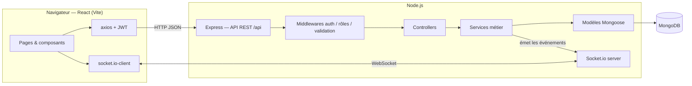

# Dossier technique — HelpDesk IT (MERN)

> Version 0.1 — conception (Sprint 1). Sera complété au fil des sprints.

## 1. Architecture



**Principe clé :** les écritures passent **toujours par l'API REST** (validation, droits, persistance). Après écriture, la couche service **émet** l'événement Socket.io vers les rooms concernées. Le socket sert à **pousser**, pas à écrire → une seule source de vérité pour les règles métier.

### Arborescence (monorepo)

```
helpdesk/
├── server/
│   ├── src/
│   │   ├── config/        # db.js, env
│   │   ├── models/        # User, Ticket, Comment, Notification, Counter
│   │   ├── routes/        # auth, tickets, comments, users, notifications, stats
│   │   ├── controllers/
│   │   ├── services/      # logique métier (transitions, historique, notifications)
│   │   ├── middlewares/   # auth, requireRole, validate, errorHandler
│   │   ├── socket/        # init io, auth handshake, handlers
│   │   ├── utils/
│   │   └── app.js / server.js
│   ├── seed/
│   └── .env.example
├── client/
│   └── src/
│       ├── api/           # instance axios
│       ├── context/       # AuthContext, SocketContext
│       ├── pages/
│       ├── components/
│       └── hooks/
├── docs/
└── README.md
```

## 2. Choix techniques

| Besoin | Choix | Justification |
|--------|-------|---------------|
| Imposé | Node.js, Express, MongoDB, Mongoose, React, Socket.io | Contraintes du sujet |
| Build front | **Vite** | Démarrage et HMR rapides, CRA déprécié |
| Routage front | React Router | Standard, gestion des routes protégées |
| Authentification | **JWT** (Bearer) + **bcrypt** | Stateless → compatible clustering ; même token réutilisé au handshake Socket.io |
| Validation des entrées | express-validator (ou Joi) | Ne jamais faire confiance au client |
| Sécurité HTTP | helmet, cors (origine du front), express-rate-limit sur `/auth` | Bonnes pratiques de base |
| Graphiques | Recharts | Simple à intégrer en React |
| Configuration | dotenv | Secrets hors du dépôt |
| Numérotation tickets | Collection `counters` + `findOneAndUpdate($inc)` | Numéro lisible `HD-0042` atomique, plus parlant qu'un ObjectId pour l'utilisateur |

## 3. Modèle de données

### 3.1 Embarquer ou référencer ?

| Donnée | Choix | Raison |
|--------|-------|--------|
| Historique du ticket | **Embarqué** dans `Ticket.history` | Toujours lu avec le ticket, volume borné (quelques dizaines d'entrées) |
| Commentaires | **Collection séparée** `comments` | Volume non borné (limite 16 Mo/doc), pagination, filtrage des notes internes |
| Auteur / assigné | **Référence** (`ObjectId` → `users`) + `populate` | Le nom/rôle peut changer, une seule source |
| Notifications | **Collection séparée** | Requêtées par utilisateur, marquées lues indépendamment |

### 3.2 Schémas

**users**
```js
{
  _id: ObjectId,
  firstName: String,        // requis
  lastName: String,         // requis
  email: String,            // requis, unique, lowercase
  password: String,         // hash bcrypt, select: false
  role: 'user' | 'technician' | 'admin',   // défaut 'user'
  department: String,       // ex. Comptabilité
  isActive: Boolean,        // défaut true
  createdAt, updatedAt
}
```

**tickets**
```js
{
  _id: ObjectId,
  number: Number,           // unique, via counters → affiché HD-0042
  title: String,            // requis, 5–120 car.
  description: String,      // requis
  category: 'hardware' | 'software' | 'network' | 'access' | 'other',
  priority: 'low' | 'medium' | 'high' | 'critical',
  status: 'open' | 'in_progress' | 'waiting_user' | 'resolved' | 'closed',
  createdBy: ObjectId → users,
  assignedTo: ObjectId → users | null,
  history: [{
    action: 'created' | 'status_changed' | 'priority_changed' | 'assigned',
    from: String, to: String,
    by: ObjectId → users,
    at: Date
  }],
  firstResponseAt: Date,    // 1ʳᵉ prise en charge → stat délai de prise en charge
  resolvedAt: Date,         // → stat délai de résolution
  closedAt: Date,
  createdAt, updatedAt
}
```

**comments**
```js
{
  _id: ObjectId,
  ticket: ObjectId → tickets,
  author: ObjectId → users,
  content: String,          // requis
  isInternal: Boolean,      // note interne support (RG6)
  createdAt
}
```

**notifications**
```js
{
  _id: ObjectId,
  recipient: ObjectId → users,
  type: 'ticket_created' | 'ticket_assigned' | 'status_changed' | 'new_comment',
  ticket: ObjectId → tickets,
  message: String,
  read: Boolean,            // défaut false
  createdAt
}
```

**counters** — `{ _id: 'ticket', seq: Number }`

### 3.3 Index

| Collection | Index | Requête servie |
|-----------|-------|----------------|
| users | `{ email: 1 }` unique | login |
| tickets | `{ number: 1 }` unique | accès par numéro |
| tickets | `{ createdBy: 1, createdAt: -1 }` | « Mes tickets » |
| tickets | `{ status: 1, priority: 1, createdAt: -1 }` | file technicien filtrée |
| tickets | `{ assignedTo: 1, status: 1 }` | « mes tickets assignés », charge par tech |
| comments | `{ ticket: 1, createdAt: 1 }` | fil du ticket |
| notifications | `{ recipient: 1, read: 1, createdAt: -1 }` | centre de notifications |

## 4. API REST

Base : `/api` — JSON — Auth : header `Authorization: Bearer <token>`.
Format d'erreur : `{ "error": { "code": "FORBIDDEN", "message": "..." } }`.

### Auth
| Méthode | Route | Accès | Description |
|---------|-------|-------|-------------|
| POST | `/auth/register` | public | Création de compte (rôle `user`) → `{ token, user }` |
| POST | `/auth/login` | public | → `{ token, user }` |
| GET | `/auth/me` | connecté | Profil courant |

### Tickets
| Méthode | Route | Accès | Description |
|---------|-------|-------|-------------|
| GET | `/tickets` | connecté | Liste paginée. `user` : ses tickets (RG1). Filtres `?status=&priority=&category=&assignedTo=me&q=&page=&limit=&sort=` |
| POST | `/tickets` | connecté | Créer un ticket |
| GET | `/tickets/:id` | propriétaire / staff | Détail + historique |
| PATCH | `/tickets/:id` | staff (titre/desc : propriétaire si `open`) | Modifier titre, description, catégorie, priorité |
| PATCH | `/tickets/:id/status` | staff ; user pour `closed` / réouverture | `{ status }` — transitions RG3 |
| PATCH | `/tickets/:id/assign` | tech (soi-même) / admin | `{ assignedTo }` |

### Commentaires
| Méthode | Route | Accès | Description |
|---------|-------|-------|-------------|
| GET | `/tickets/:id/comments` | propriétaire / staff | Notes internes exclues pour `user` |
| POST | `/tickets/:id/comments` | propriétaire / staff | `{ content, isInternal }` (`isInternal` ignoré pour `user`) |

### Utilisateurs (admin)
| Méthode | Route | Accès | Description |
|---------|-------|-------|-------------|
| GET | `/users` | admin (tech : `?role=technician` pour la liste d'assignation) | Liste |
| PATCH | `/users/:id` | admin | `{ role, isActive }` |

### Notifications
| Méthode | Route | Accès | Description |
|---------|-------|-------|-------------|
| GET | `/notifications` | connecté | Les miennes, non lues d'abord |
| PATCH | `/notifications/:id/read` | destinataire | Marquer lue |
| PATCH | `/notifications/read-all` | connecté | Tout marquer lu |

### Statistiques (admin)
| Méthode | Route | Description |
|---------|-------|-------------|
| GET | `/stats/overview` | Nb de tickets par statut et par priorité |
| GET | `/stats/by-category` | Volume + délai moyen de résolution par catégorie |
| GET | `/stats/technicians` | Tickets ouverts / résolus par technicien |
| GET | `/stats/timeline?from=&to=` | Tickets créés / résolus par jour |

Codes : `200` OK · `201` créé · `400` validation · `401` non authentifié · `403` interdit · `404` introuvable · `409` conflit (email existant, transition invalide).

## 5. Temps réel — Socket.io

**Connexion :** `io(URL, { auth: { token } })` → middleware serveur vérifie le JWT, attache `socket.user`, rejoint automatiquement :
- `user:<userId>` (notifications personnelles)
- `staff` si rôle `technician` ou `admin`

| Sens | Événement | Payload | Room cible | Déclencheur |
|------|-----------|---------|-----------|-------------|
| C → S | `ticket:join` | `{ ticketId }` | — | Ouverture d'un ticket (droits vérifiés) |
| C → S | `ticket:leave` | `{ ticketId }` | — | Fermeture de la page |
| S → C | `ticket:created` | ticket | `staff` | POST /tickets |
| S → C | `ticket:updated` | `{ ticketId, changes, historyEntry }` | `ticket:<id>` + `staff` | statut / priorité / assignation |
| S → C | `comment:created` | comment | `ticket:<id>` (internes : sockets staff uniquement — RG6) | POST comment |
| S → C | `notification:new` | notification | `user:<id>` | toute notification persistée |
| C ↔ S | `typing` | `{ ticketId, isTyping }` | `ticket:<id>` (sauf émetteur) | COULD US16 |

Pour les notes internes : room dédiée `ticket:<id>:staff` rejointe uniquement par les sockets staff.

## 6. Exploitation statistique (Aggregation Pipeline)

Choix : **Aggregation Pipeline** plutôt que MapReduce (déprécié depuis MongoDB 5.0, moins performant, s'exécute en JS).

Exemple — délai moyen de résolution par catégorie (en heures) :
```js
Ticket.aggregate([
  { $match: { resolvedAt: { $ne: null } } },
  { $project: {
      category: 1,
      hours: { $divide: [{ $subtract: ['$resolvedAt', '$createdAt'] }, 3600000] }
  } },
  { $group: { _id: '$category', avgHours: { $avg: '$hours' }, count: { $sum: 1 } } },
  { $sort: { avgHours: -1 } }
]);
```

Autres pipelines prévus : `$group` par statut/priorité (`$facet` pour tout en une requête), charge par technicien (`$match` statut ouvert → `$group` par `assignedTo` → `$lookup` users), timeline (`$dateToString` par jour).

## 7. Montée en charge (réflexion)

| Niveau | Mécanisme | Application au HelpDesk |
|--------|-----------|------------------------|
| Disponibilité BDD | **Replica set** (1 primaire + 2 secondaires) | Bascule automatique si le primaire tombe ; lectures de stats sur secondaires (`readPreference: secondaryPreferred`) pour ne pas charger le primaire |
| Volume BDD | **Sharding** | Pertinent seulement à très grande échelle (multi-entités). Clé candidate pour `tickets` : `{ createdBy: 'hashed' }` (répartition homogène, « mes tickets » ciblé) ; éviter `createdAt` seul (clé monotone → hotspot sur un shard). `comments` : `{ ticket: 1 }` pour co-localiser le fil d'un ticket |
| Serveur Node | **Clustering** (module `cluster` ou PM2 `-i max`) | 1 process par cœur CPU. Possible car l'API est **stateless** (JWT) |
| Socket.io multi-process | **@socket.io/redis-adapter** + **sticky sessions** | Sans adapter, un événement émis par le process A n'atteint pas un client connecté au process B. Sticky sessions nécessaires pour le polling HTTP initial |
| Frontal | Reverse proxy Nginx / load balancer | Répartition, TLS, service des fichiers statiques React |

Pour la démo : un seul process + un seul mongod suffisent ; la réflexion sera présentée en soutenance.
