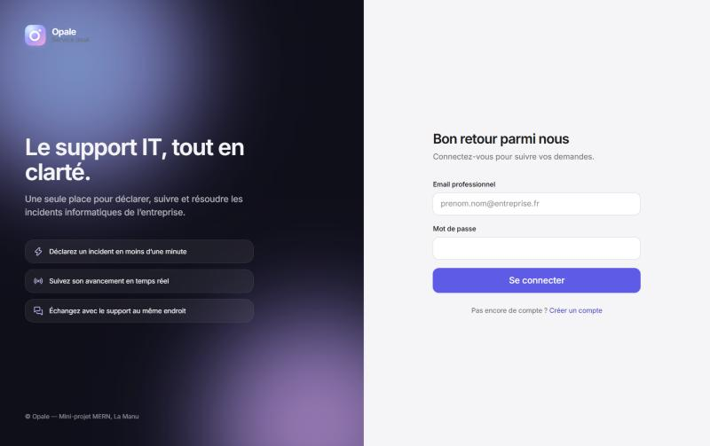
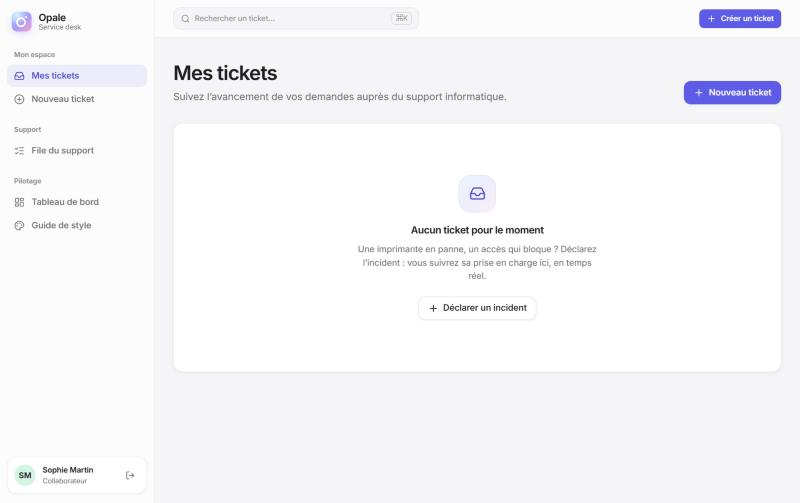
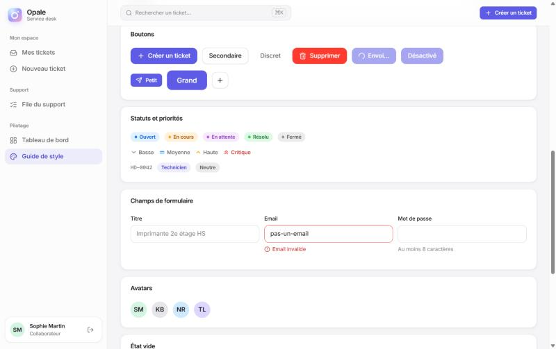
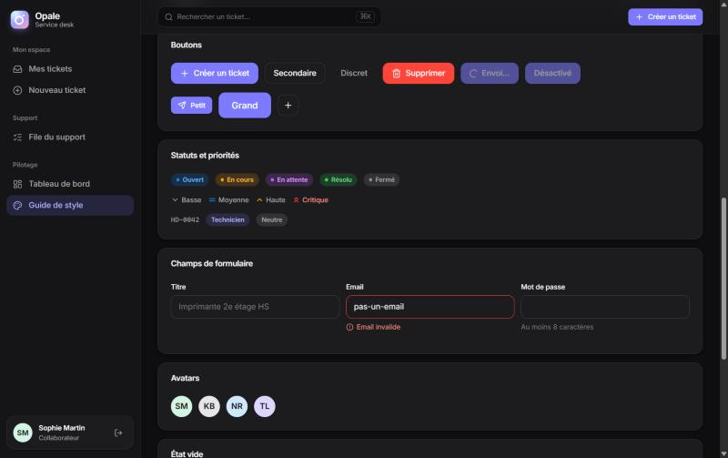

# Charte graphique — Opale

> Identité visuelle et design system de l'application (US21).
> Référence vivante dans l'application : page **`/styleguide`**. Code : `client/src/styles/` et `client/src/components/ui/`.

<p align="center"></p>

## 1. Identité

|                  |                                   |
| ---------------- | --------------------------------- |
| **Nom**          | **Opale**                         |
| **Signature**    | _Le support IT, tout en clarté._  |
| **Descripteur**  | Service desk                      |
| **Personnalité** | Calme, clair, fiable, attentionné |

**Pourquoi « Opale » ?** L'opale est une pierre douce et lumineuse, aux reflets changeants. Elle porte les deux promesses de l'outil : **la clarté** (réponse au manque de visibilité, problème P2 du cadrage) et **le calme** (un incident informatique est stressant ; l'outil doit apaiser, pas ajouter de la tension). Nom court, prononçable, sans connotation technique, qui sonne « premium ».

### Logo

| Élément                                                         | Signification                                                        |
| --------------------------------------------------------------- | -------------------------------------------------------------------- |
| **Squircle** (carré aux coins continus, forme des icônes Apple) | Douceur, objet familier et soigné                                    |
| **Dégradé irisé** ciel → lavande → rose                         | Les reflets d'une opale ; seule touche de couleur vive de l'identité |
| **Anneau blanc**                                                | Le « O » d'Opale ; un ticket qui suit son cycle complet              |
| **Éclat** en haut à droite                                      | La clarté, l'incident résolu                                         |

Fichiers : `docs/identite/opale-symbole.svg`, `client/public/favicon.svg`, composant `components/brand/Logo.jsx` (`<Logo />` symbole + nom, `<LogoMark />` symbole seul).

**Règles** : symbole toujours sur fond uni ; taille minimale 16 px ; ne pas déformer, recolorer ni ajouter d'ombre portée forte ; le nom s'écrit « Opale » (jamais en capitales).

## 2. Sources d'inspiration

| Source                                 | Ce que nous reprenons                                                                                                                                                                                       |
| -------------------------------------- | ----------------------------------------------------------------------------------------------------------------------------------------------------------------------------------------------------------- |
| **Maquettes du projet**                | Structure des écrans : listes filtrables, détail avec panneau de gestion, tableau de bord à indicateurs                                                                                                     |
| **Jira**                               | Coque d'application (barre latérale par groupes + barre supérieure avec recherche et bouton « Créer »), **clés de ticket** (`HD-0042`), **pastilles de statut** colorées, **icônes de priorité** en flèches |
| **Apple (Human Interface Guidelines)** | Gris système, typographie dense et lisible, coins continus, **matériau translucide** (barres en verre dépoli), ombres très douces, thème sombre automatique, sobriété                                       |
| **Tendances UX actuelles**             | Grilles « bento », états vides utiles, micro-interactions discrètes, animations respectant `prefers-reduced-motion`, accessibilité dès la conception                                                        |

**Intention** : _doux, luxueux, premium_. Le luxe vient de la **retenue** : beaucoup d'espace, peu de couleurs, des détails soignés (transitions, ombres, focus), jamais d'effet gratuit.

## 3. Couleurs

Toutes les couleurs sont des **variables CSS** (`client/src/styles/tokens.css`) redéfinies pour le thème sombre. Aucune couleur n'est écrite en dur dans les composants.

### Neutres et accent

| Rôle                                                  | Clair                         | Sombre    | Variable                 |
| ----------------------------------------------------- | ----------------------------- | --------- | ------------------------ |
| Fond de l'application                                 | `#F5F5F7`                     | `#0E0E10` | `--color-bg`             |
| Surface (cartes)                                      | `#FFFFFF`                     | `#1C1C1E` | `--color-surface`        |
| Texte                                                 | `#1D1D1F`                     | `#F5F5F7` | `--color-text`           |
| Texte secondaire                                      | `#6E6E73`                     | `#A1A1A6` | `--color-text-secondary` |
| Bordures                                              | noir 8 %                      | blanc 9 % | `--color-border`         |
| **Accent Opale** (actions principales, élément actif) | `#5E5CE6`                     | `#7D7AFF` | `--color-accent`         |
| Danger                                                | `#FF3B30`                     | `#FF453A` | `--color-danger`         |
| **Dégradé Opale** (logo, accents rares)               | `#8FD3FE → #A99BFB → #F3A7D6` | —         | `--gradient-opale`       |

L'accent est un **indigo doux** (proche de l'indigo système d'Apple) : premium et apaisant, distinct du bleu des statuts.

### Statuts des tickets

Chaque statut a une pastille (couleur pleine), un texte foncé et un fond teinté à ~12 % : lisible, doux, et jamais porteur d'information **par la couleur seule** (le libellé est toujours affiché).

| Statut         | Couleur          | Libellé    |
| -------------- | ---------------- | ---------- |
| `open`         | Bleu `#0A84FF`   | Ouvert     |
| `in_progress`  | Orange `#FF9F0A` | En cours   |
| `waiting_user` | Violet `#BF5AF2` | En attente |
| `resolved`     | Vert `#30D158`   | Résolu     |
| `closed`       | Gris `#8E8E93`   | Fermé      |

### Priorités (inspiration Jira)

| Priorité | Icône               | Couleur               |
| -------- | ------------------- | --------------------- |
| Basse    | flèche vers le bas  | gris                  |
| Moyenne  | égal                | bleu                  |
| Haute    | flèche vers le haut | orange                |
| Critique | double flèche       | rouge (libellé rouge) |

## 4. Typographie

**Inter** (variable, hébergée localement via `@fontsource-variable/inter`) — l'équivalent libre le plus proche de SF Pro, la police d'Apple dont la licence interdit l'usage web. Repli : `-apple-system` (SF Pro sur Mac / iPhone), `Segoe UI`, `system-ui`.

| Usage            | Taille                      | Graisse | Approche |
| ---------------- | --------------------------- | ------- | -------- |
| Titre de page    | 34 px                       | 620     | −3,2 %   |
| Titre de section | 20 px                       | 620     | −2,2 %   |
| Texte courant    | 15 px                       | 420     | −0,6 %   |
| Légende, badges  | 12–13 px                    | 420–620 | normal   |
| Clés de ticket   | 13 px, police à chasse fixe | —       | —        |

Approche (letter-spacing) légèrement négative sur les grands textes, comme chez Apple, pour un rendu dense et élégant ; variantes Inter `cv11` / `ss01` pour une meilleure lisibilité.

## 5. Formes, espaces, profondeur, mouvement

| Thème          | Règle                                                                                                                                                                               |
| -------------- | ----------------------------------------------------------------------------------------------------------------------------------------------------------------------------------- |
| **Espacement** | Grille de 4 px (`--space-1` à `--space-16`) ; contenu limité à 1 180 px de large                                                                                                    |
| **Rayons**     | 8 px (petits contrôles) · 12 px (boutons, champs) · 16 px (cartes) · 22 px (grands panneaux)                                                                                        |
| **Ombres**     | En couches, très diffuses (`--shadow-xs` à `--shadow-lg`) ; ombre colorée sur le bouton principal au survol                                                                         |
| **Matériau**   | Barre latérale et barre supérieure en **verre dépoli** (`backdrop-filter: blur(20px) saturate(180%)`)                                                                               |
| **Mouvement**  | 120–360 ms, courbe `cubic-bezier(0.22, 1, 0.36, 1)` ; apparition douce des pages (`fade-up`) ; légère réduction au clic (`scale(0.98)`) ; **désactivé si `prefers-reduced-motion`** |

## 6. Composants

| Composant                       | Fichier             | Usage                                                                                                                                  |
| ------------------------------- | ------------------- | -------------------------------------------------------------------------------------------------------------------------------------- |
| `Button`                        | `ui/Button.jsx`     | Variantes `primary` / `secondary` / `ghost` / `danger`, tailles `sm` / `md` / `lg`, icône, état `loading`, rendu en lien (`as={Link}`) |
| `FormField`                     | `FormField.jsx`     | Libellé, aide, erreur de l'API (`error.details`), accessible (`aria-invalid`, `aria-describedby`)                                      |
| `Badge`                         | `ui/Badge.jsx`      | Pastilles génériques (rôle, US…)                                                                                                       |
| `StatusBadge` / `PriorityBadge` | `tickets/*.jsx`     | Statut et priorité d'un ticket, libellés français                                                                                      |
| `Card`                          | `ui/Card.jsx`       | Surface avec titre et actions optionnels                                                                                               |
| `PageHeader`                    | `ui/PageHeader.jsx` | Fil d'Ariane, titre, description, actions                                                                                              |
| `EmptyState`                    | `ui/EmptyState.jsx` | Jamais d'écran vide : explication + action suivante                                                                                    |
| `Avatar`                        | `ui/Avatar.jsx`     | Initiales sur pastel stable par personne                                                                                               |
| `Spinner` / `PageLoader`        | `ui/Spinner.jsx`    | Chargements                                                                                                                            |
| `Logo` / `LogoMark`             | `brand/Logo.jsx`    | Identité                                                                                                                               |

Libellés français des valeurs de l'API : `client/src/constants/labels.js`. Navigation : `client/src/constants/navigation.js`.

## 7. Mise en page

```
┌──────────────┬──────────────────────────────────────────────┐
│  ◉ Opale     │  🔍 Rechercher un ticket…  ⌘K   [+ Créer]    │ ← barre supérieure (verre)
│              ├──────────────────────────────────────────────┤
│  MON ESPACE  │  Mes tickets                    [+ Nouveau]  │ ← PageHeader
│  ▸ Mes tick. │  Suivez l'avancement…                        │
│  ▸ Nouveau   │  ┌────────────────────────────────────────┐  │
│  SUPPORT     │  │                                        │  │ ← Card + contenu
│  ▸ File      │  │                                        │  │
│  PILOTAGE    │  └────────────────────────────────────────┘  │
│  ▸ Tableau   │                                              │
│ ┌──────────┐ │                                              │
│ │SM Sophie │ │                                              │ ← carte utilisateur
│ └──────────┘ │                                              │
└──────────────┴──────────────────────────────────────────────┘
```

- **≥ 900 px** : barre latérale fixe (264 px) + barre supérieure collante.
- **< 900 px** : barre latérale en **tiroir** (bouton menu, fond assombri, fermeture par Échap, clic sur le fond ou sur un lien) ; logo dans la barre supérieure.
- **Connexion / inscription** : écran partagé — panneau de marque sombre à halos irisés animés (gauche) + formulaire (droite) ; formulaire seul sur mobile.

### Aperçu

| Connexion                                            | Mes tickets                                       |
| ---------------------------------------------------- | ------------------------------------------------- |
|  |    |
| **Composants (clair)**                               | **Thème sombre**                                  |
|         |  |

## 8. Ton éditorial

- Vouvoiement, phrases courtes, verbes d'action (« Déclarer un incident », « Prendre en charge »).
- Les états vides **expliquent et proposent** (« Aucun ticket pour le moment — Déclarer un incident »).
- Les erreurs disent **quoi faire** (« Au moins 8 caractères, dont une lettre et un chiffre »).
- Typographie française : apostrophe typographique (’), espace avant « : ».

## 9. Accessibilité

| Exigence             | Mise en œuvre                                                                                                                  |
| -------------------- | ------------------------------------------------------------------------------------------------------------------------------ |
| Contrastes AA        | Texte secondaire `#6E6E73` sur `#F5F5F7` ≈ 4,6:1 ; bouton accent texte blanc ≈ 5:1 ; textes de statut foncés sur fonds teintés |
| Focus visible        | Anneau `--color-focus` de 3 px au clavier (`:focus-visible`), halo sur les champs                                              |
| Navigation clavier   | Lien d'évitement « Aller au contenu », tiroir fermable par Échap                                                               |
| Sens sans la couleur | Statuts et priorités toujours accompagnés d'un libellé                                                                         |
| Formulaires          | Libellés associés, erreurs reliées par `aria-describedby`, `aria-invalid`                                                      |
| Mouvement            | Animations neutralisées si `prefers-reduced-motion`                                                                            |
| Thème                | Clair / sombre selon le système (`prefers-color-scheme`)                                                                       |

## 10. Règles pour l'équipe

1. **Jamais de couleur, taille, rayon ou ombre en dur** : utiliser les variables de `tokens.css`.
2. **Réutiliser les composants** de `components/ui/` avant d'en créer ; un nouveau composant générique s'ajoute au guide `/styleguide`.
3. Toute liste a un **état vide**, tout chargement un **indicateur**, toute erreur de l'API un **message** lisible.
4. Afficher les **libellés** (`constants/labels.js`), jamais les valeurs techniques (`in_progress`).
5. Vérifier chaque écran en **clair, sombre et mobile** (375 px) avant la PR.
